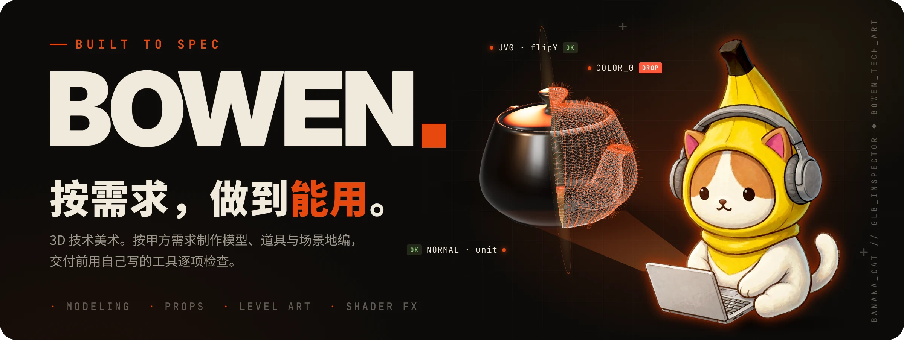
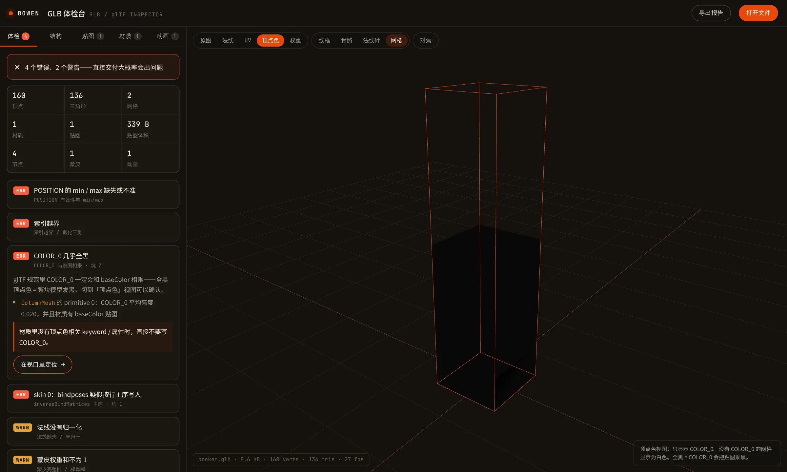

<p align="center">
  <a href="https://yigenjiao.github.io/Bowen/"></a>
</p>

<p align="center">
  <strong><a href="https://yigenjiao.github.io/Bowen/">个人主页</a></strong> &nbsp;·&nbsp;
  <strong><a href="https://yigenjiao.github.io/Bowen/tools/glb-inspector/">GLB 体检台</a></strong> &nbsp;·&nbsp;
  <a href="#联系">联系我</a>
</p>

<p align="center">
  
  
  
</p>

我是 **Bowen**，3D 游戏技术美术。根据甲方需求制作**模型、道具和场景地编**，
也接已有资源的整理、改版，以及溶解、河流、卡通渲染这类 Shader 效果。

交付标准 GLB 和贴图集，附节点结构表，导进引擎就能用。

## 🧰 GLB 体检台：把踩过的坑做成工具

<p align="center">
  <a href="https://yigenjiao.github.io/Bowen/tools/glb-inspector/?sample=broken.glb"></a>
</p>

<p align="center">
  <strong><a href="https://yigenjiao.github.io/Bowen/tools/glb-inspector/">打开体检台 →</a></strong> &nbsp;·&nbsp;
  <a href="https://yigenjiao.github.io/Bowen/tools/glb-inspector/?sample=broken.glb">看它怎么抓一个坏样本</a>
</p>

把 `.glb` 拖进浏览器，几秒内告诉你**这个模型交付出去会不会出事**。全部在本地运行，文件不会上传。

它不靠 three.js 的渲染结果猜问题，而是直接读 glTF 的原始字节逐项检查。规则来自真实交付里踩过的坑：

| 检查 | 会发生什么 |
| --- | --- |
| **bindposes 主序写反** | 平移落在 `[3,7,11]`，模型一播动画就被甩飞 |
| **accessor 按 float64 落盘** | 声明 FLOAT 却写了 8 字节，读出来全是乱码 |
| **COLOR_0 乘贴图** | 蓝色贴图被染红，或者整块发黑 |
| **GLB 的 buffer 带 uri** | three.js / Blender 报 `Failed to load buffer` |
| 索引越界 · 法线未归一 · 缺 min/max | 破面、光照异常、某些角度模型消失 |
| 蒙皮权重和 · 骨骼索引越界 | 动起来整块缩放、顶点乱飞 |
| 零缩放节点 · 贴图格式与尺寸 | 运行时隐藏态被误删、移动端贴图加载失败 |

每条问题都附带**成因和修复写法**，可以一键定位到出问题的网格。另有法线、UV 棋盘格、顶点色、骨骼权重四种检查视图，也可以导出 Markdown 体检报告附在交付里。

## 能直接交付的能力

| | 能力 | 内容 |
| --- | --- | --- |
| 01 | **模型与道具** | 按需求制作道具、建筑和场景物件，控制面数与贴图规格，适配目标引擎和平台 |
| 02 | **场景地编** | 按玩法和参考搭建关卡场景，整理摆位、层级与材质，已有场景也可以改版重做 |
| 03 | **Shader 效果** | 按参考实现溶解、河流、卡通渲染等效果，参数可调，可以接进 Unity 管线 |
| 04 | **AI 工作流** | 概念出图、批量素材生成与自动化脚本，把重复劳动交给流水线 |

做过的案例（整场景交付、Shader 效果、主题改版，以及一次交付 3732 个模型的大场景）见[个人主页](https://yigenjiao.github.io/Bowen/#cases)。

## 仓库里有什么

```
index.html                       个人主页
tools/glb-inspector/             GLB 体检台（单文件，无需构建）
  samples/                       健康样本 / 故意埋坑的样本 + 生成脚本
assets/                          封面、截图、二维码
.github/cover/                   README 封面的源文件（HTML + three.js），可以重新生成
```

## 联系

模型、道具、场景地编、资源改版和 Shader 效果，都可以直接聊。
说清楚用途、风格参考和交付格式，我先评估工期。

- **Email**：shiboxun123@gmail.com
- **GitHub**：[@yigenjiao](https://github.com/yigenjiao)
- **微信**：扫下面的二维码


