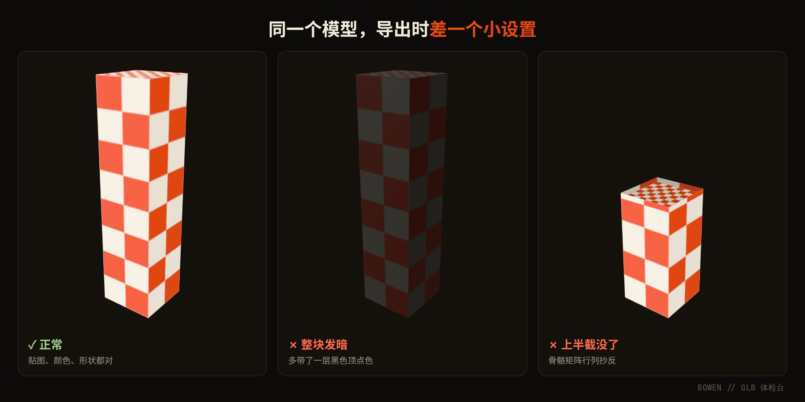
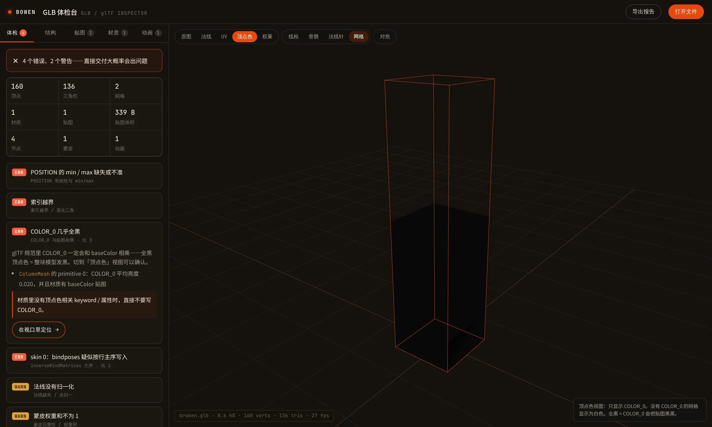

# 模型一进网页就发黑、少半截、加载失败？导出 GLB 最常见的 4 个坑

> 备选标题：
> - 《Blender 里好好的，一导出就出事：GLB 的 4 个隐形坑》
> - 《我把导出 3D 模型踩过的坑，做成了一个免费小工具》

---

做 3D 的朋友大概都遇到过这种事：

模型在 Blender 里看着好好的，导出成 GLB，扔进网页或者引擎，然后……

- 整个模型**黑了一块**；
- 一播动画，角色**少了半截**，或者被甩到天上；
- 干脆直接报错，**加载失败**。

最气人的是，你回头检查，贴图没问题，模型也没问题，什么都看不出来。

我最近做了不少试玩广告的资源提取和还原，单是一个项目就导出过三千多个模型，这些坑基本都踩了个遍。今天挑最常见的 4 个，用大白话讲讲它们到底是怎么回事。

*上图是同一个模型。左边正常，中间和右边各自只差了一个小设置。*

---

## 坑 1：模型整块发黑、发暗，颜色不对

**症状：** 贴图明明是彩色的，模型却暗得像蒙了一层灰。或者蓝色的柱子莫名其妙变成了红色。

**大白话解释：**

一个模型身上，除了贴图，还可以给每个顶点单独“涂一层颜色”，叫**顶点色**。

GLB 的规矩是：**最终颜色 = 贴图颜色 × 顶点色**。

顶点色是白色的时候，乘出来跟原来一样，没事。可要是顶点色是黑的，那乘出来就是黑的；顶点色偏红，整个模型就偏红。

为什么会多出这层颜色？因为很多游戏里，顶点色根本不是拿来“上色”的，而是给特效当遮罩、记录风吹的强度之类。原来的引擎知道怎么用它，但导出成 GLB 之后，所有看这个模型的软件都会老老实实地把它乘到颜色上。

**怎么办：** 如果原来的材质没有真的在用顶点色上色，导出时就**别把顶点色带上**。

---

## 坑 2：一播动画，模型少半截、乱飞、拉成面条

**症状：** 静止的时候还好，一动就崩：要么一部分直接消失，要么被拉出长长的尖刺，要么整个角色飞出屏幕。

**大白话解释：**

带骨骼的模型，每根骨头都要记一张“我一开始在哪”的小表格，4 行 4 列，16 个数。

问题在于，这张表有两种抄法：**一行一行抄**，或者**一列一列抄**。GLB 规定必须**一列一列抄**。

很多工具和代码默认是一行一行抄的。抄反了之后，本来表示“往上挪 1 米”的那个数，就跑到了一个完全不该在的格子里。软件按错的表去算，模型自然就散架了。

就像填快递单时，把“省市区”和“门牌号”填错了格：每个字都没错，但包裹肯定送不到。

**怎么办：** 导出骨骼时，确认矩阵是**按列**写进去的。如果是自己写脚本导出，这一步非常容易漏。

---

## 坑 3：直接报错 “Failed to load buffer”

**症状：** 在 three.js 或 Blender 里一打开就报错，提示找不到某个 `.bin` 文件。可你明明导出的是一个 GLB，根本没有什么 `.bin`。

**大白话解释：**

GLB 的好处是“一个文件全打包”：模型数据、贴图都装在同一个文件里。

但如果导出的时候，文件里还留着一句“数据在外面的 xxx.bin 里”，加载器就会信以为真，跑出去找那个文件，结果当然找不到。

就像你收到一个快递，东西其实就在箱子里，但箱子里还塞了张纸条写着“货在隔壁”。快递员看到纸条，就跑去隔壁敲门了。

**怎么办：** 导出 GLB 时，把这句“数据在外面”的说明删掉，让软件老老实实地读包里的东西。

---

## 坑 4：读出来全是乱码，模型炸成一团刺猬

**症状：** 模型的形状完全不对，满屏乱飞的三角形，像一团爆炸的刺猬。

**大白话解释：**

GLB 文件里会先写清楚：“下面每个数字占 4 个格子”。读的软件就按 4 格一个地去读。

但有些导出工具（特别是自己用 Python 写的脚本）一不小心，实际上用 8 个格子存了一个数。声明的是 4 格，写的是 8 格，读的人按 4 格一读，后面全部错位，读出来自然是一堆乱码。

就像抄电话号码时，每个数字都写了两遍：照着拨，肯定打不通。

**怎么办：** 写入数据前，把数据类型统一转成文件里声明的那种。

---

## 还有一些小坑

- **某些角度模型突然消失：** 文件里记录的“模型有多大”写错了，软件以为它不在画面里，就不画了。
- **模型光照怪怪的，有的地方特别亮或特别暗：** 法线（决定光怎么反射的方向）长度不对。
- **有些零件导出后看不见：** 它在原来的游戏里本来就是“缩小到 0、等播动画时才弹出来”的隐藏状态，并不是导出错了，**千万别直接删**。

---

## 一个一个查太累？我做了个小工具

这些坑有个共同点：**光用眼睛看，很难发现**。等发现的时候，往往已经交付出去了。

所以我把它们做成了一个免费的网页小工具：**GLB 体检台**。

用法很简单：

1. 打开网页，把 `.glb` 文件拖进去；
2. 几秒钟后，左边会列出所有问题，告诉你**为什么会这样**，以及**该怎么改**；
3. 点“在视口里定位”，直接跳到出问题的那块模型。

几个特点：

- **不用安装**，打开网页就能用，手机也能看；
- **文件不会上传**，全部在你自己的浏览器里处理，不用担心项目泄露；
- **全中文**，每个问题都说人话；
- 可以导出一份体检报告，附在交付里。

👉 **地址：https://yigenjiao.github.io/Bowen/tools/glb-inspector/**

如果不知道效果怎么样，可以先点“看坏样本”，里面故意埋了好几个坑，看它能不能全部抓出来。

---

如果你也踩过别的导出坑，欢迎在评论区告诉我，我会陆续加进工具里。

如果你手上有试玩广告、Cocos 项目需要提取资源，或者模型导出总出问题，也可以直接找我聊。🍌🐱
